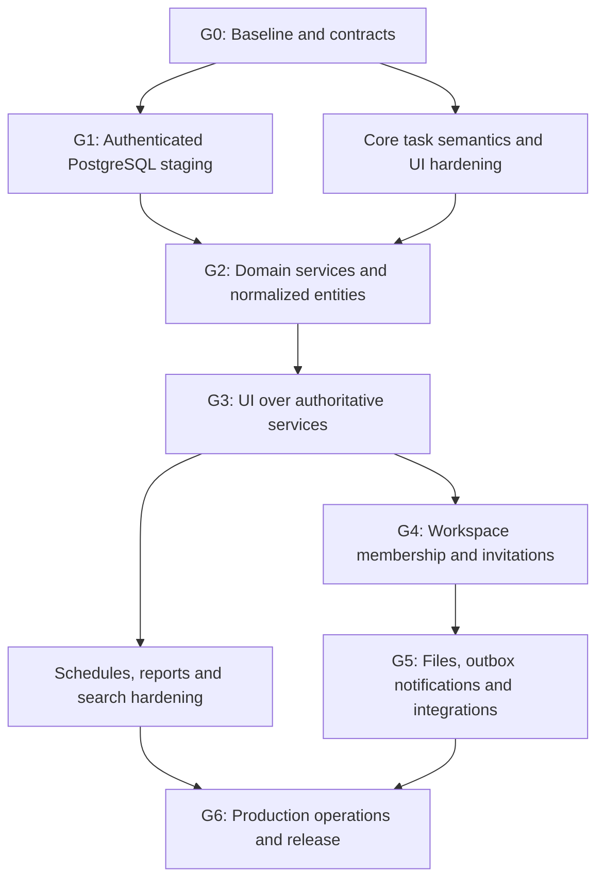

# Taskora full-scale execution backlog

**Status:** Prepared backlog; items are not marked complete without evidence  
**Reviewed:** 2026-10-18  
**Target source:** GitHub Track A, `Loofy147/Taskora`  
**Companion:** [Full-system blueprint](FULL_SYSTEM_BLUEPRINT.md)  
**Current independent staging surface:** AppDeploy Track B, revision `1792339899173`; cloud UI deferred; E2E result not returned

This backlog intentionally prioritizes system-wide correctness and an incremental production path over isolated cloud-revision debugging or repeated deployments.

## Priority definitions

- **P0 — release/safety gate:** blocks durable data, security or safe release.
- **P1 — core product:** needed for reliable daily task/work management.
- **P2 — scale/extension:** required only after core usage and need are demonstrated.

## Delivery rules

1. Every task has a test-first acceptance contract. For behavior changes, write the failing test before the implementation, then prove red → green → regression suite.
2. Each PR should implement a coherent domain increment; avoid sprawling PRs that change auth, database schema, UI navigation and deployment configuration together.
3. Do not use AppDeploy deployments as a save button. Finish the source, tests, docs, migration and rollback plan first; deploy one complete candidate when it is justified.
4. Do not store secrets in code/docs or request tokens in chat.
5. Track A and Track B require separate evidence records. Do not treat AppDeploy `ready` as GitHub deployment evidence or GitHub CI as AppDeploy E2E evidence.
6. Mark each acceptance item PASS, FAIL or NOT RUN with commit/revision, test/run ID and evidence. Unknown is not pass.

## Workstream dependency map

UI-only improvements to existing local workflows can proceed in parallel with G1, but cannot be used to imply that authenticated persistence is complete.

## G0 — System baseline and product contracts

### FS-001 — Confirm one canonical implementation and release boundary — P0
**Work:** Treat Track A (GitHub source) as canonical. Label Track B as an independent preview/smoke surface. Review open PR #17 and the dependency PR queue separately; do not merge risky major dependency updates just to make the queue empty.

**Acceptance:**
- Current commit/revision, environment flags, test commands and deployed track are recorded.
- No documentation states Track B code is synchronized into GitHub.
- AppDeploy remains staging-only; cloud persistence remains deferred until its own gate passes.

### FS-002 — Establish domain schema and invariants — P0
**Work:** Write shared Zod/domain validators for Task, Project, Membership, Comment, Subtask, ScheduleInterval, Backup and mutation inputs. Remove hard-coded demo identity from any path used by authenticated server persistence.

**Acceptance:**
- Empty/overlong titles, invalid dates, incomplete/reversed intervals, duplicated IDs, dangling references and unauthorized assignees are rejected.
- A rejected operation leaves prior state unchanged.
- UI, server and backup parsers use the same versioned contract or tested adapters.

### FS-003 — Capability matrix and threat boundaries — P0
**Work:** Encode Owner/Admin/Member/Viewer abilities in a central policy module. Keep responsibility descriptions separate from roles.

**Acceptance:**
- Tests enumerate every role × read/write operation.
- Anonymous/expired/revoked users and cross-workspace object IDs are denied server-side.
- Owner transfer, invitation acceptance and role changes are explicit transactional actions.
- UI visibility tests do not substitute for server authorization tests.

### FS-004 — Test and release evidence ledger — P0
**Work:** Map each important capability to unit/integration/E2E/operational evidence. Add a release record format and preserve known limitations.

**Acceptance:**
- CI records exact commit and commands.
- Migration skipped due to absent `DATABASE_URL` is recorded as SKIPPED, not PASSED.
- No test-definition file is described as an executed test result.

## G1 — Real authentication and PostgreSQL staging

### FS-010 — Configure an isolated authenticated staging environment — P0
**Depends on:** FS-001, FS-003.  
**Work:** Set the intended environment flags and providers through approved deployment settings; configure `VITE_AUTH_ENABLED=true`, `BETTER_AUTH_URL`, `BETTER_AUTH_SECRET` and `DATABASE_URL` only in secret storage. Leave preview mode fail-closed.

**Acceptance:** the selected environment and callbacks are documented without secrets; real sign-up/sign-in/session refresh/sign-out/expiry are exercised in a browser; local preview remains isolated from staging.

### FS-011 — Verify auth and application migrations — P0
**Depends on:** FS-010.  
**Work:** Apply canonical Better Auth schema and workspace-storage migration to a disposable staging database. Strengthen preflight and CI so generated auth-schema drift/missing inputs fail closed.

**Acceptance:** clean database migration succeeds; repeat migration is idempotent; expected tables/indexes/constraints exist; migration failure prevents release; test environment is isolated from production; rollback/recovery steps are recorded.

### FS-012 — Execute browser snapshot bridge tests — P0, temporary gate only
**Depends on:** FS-011.  
**Work:** Exercise the current personal snapshot bridge only as a staging integration prerequisite, not as the permanent domain model.

**Acceptance:** authenticated initialize/load/save/restore works after reload; stale revision returns explicit conflict; database/network failure preserves the local draft; two independent accounts cannot inspect or mutate one another; browser results and transcript are stored. If this bridge cannot pass, keep it disabled and fix its root cause only if it is still required for migration.

### FS-013 — Define safe snapshot-to-relational conversion — P0
**Depends on:** FS-002, FS-011.  
**Work:** Build a preview/dry-run importer from backup v1/snapshot data to normalized records, with deterministic ID mapping, collision detection and transactional write.

**Acceptance:** import preview reports accepted/rejected rows without writes; confirmation is required; repeated import is idempotent; identical IDs with divergent content fail closed; transaction rollback leaves the original state unchanged; imported workspace is validated before becoming active.

## G2 — Authoritative domain services and per-entity storage

### FS-020 — Add repository/service interfaces for core entities — P0
**Depends on:** FS-002, FS-011.  
**Work:** Define task/project/subtask/comment/membership repositories and service operations. Keep database, auth and UI components out of domain rules.

**Acceptance:** services can be tested with PostgreSQL/PGlite contract tests; service methods require an actor context and workspace scope; repository methods cannot silently use an unscoped object ID.

### FS-021 — Task create/read/update/status/archive — P0
**Depends on:** FS-020.  
**Work:** Normalize task records and implement bounded list queries, per-task versions and transactional mutations.

**Acceptance:** create/read/patch/status/archive pass positive and negative integration tests; stale versions return 409 without overwriting newer data; referenced project and assignees must exist in the same workspace; retry with an idempotency key does not create duplicate tasks.

### FS-022 — Projects, assignments, subtasks and comments — P0
**Depends on:** FS-021.  
**Work:** Normalize project and child/relationship entities; apply consistent workspace and lifecycle rules.

**Acceptance:** no dangling reference; comment/subtask permissions match the policy matrix; deletion/archive of parents has an explicitly tested dependency policy; paging and project-specific queries are bounded.

### FS-023 — Idempotency, conflict and recovery contracts — P0
**Depends on:** FS-021.  
**Work:** Standardize mutation response/error types, expected versions, idempotency keys, cancellation/timeouts and retry guidance.

**Acceptance:** duplicate request retries are safe; stale writes preserve drafts; 400/401/403/404/409/413/429/503 are distinguishable; client refresh/reapply recovery is tested, not just documented.

### FS-024 — Atomic audit and event boundaries — P1
**Depends on:** FS-021.  
**Work:** Add minimal append-only audit events for task/project/membership/invitation/import actions. Avoid logging private bodies.

**Acceptance:** domain mutation and audit/outbox insertion commit atomically where required; failed transaction leaves neither partial mutation nor misleading event; records carry redacted actor/workspace/action/correlation metadata.

## P1 — Reliable daily workflow and interface

These tasks can start earlier using local state and unit tests, but acceptance must be repeated against the service-backed UI after G3.

### FS-030 — Route model, deep links and navigation state — P1
**Work:** Give Board, List, Calendar, Projects, Team and task detail stable route/deep-link semantics; preserve expected history and back/forward behavior.

**Acceptance:** direct-load and refresh every route; opening a task can be linked; back/forward recovers the expected view; filters are preserved or cleared according to documented rules; unauthorized links return a safe denial/not-found screen.

### FS-031 — Unified task filter/search behavior — P1
**Work:** Unify text query, status, priority, project, assignee and date filters across List/Board/Calendar where semantically appropriate.

**Acceptance:** conjunction behavior is deterministic; Clear filters resets exactly the listed filters; no-results state has recovery guidance; server pagination does not break counts or lose results.

### FS-032 — Schedule domain and conflict warnings — P1
**Work:** Separate date-only due dates from scheduled intervals; store timezone-aware instants; add soft overlap warnings.

**Acceptance:** missing/invalid date and partial/reversed times are rejected; overlap warning names affected task/person/time; cancel makes no write; override requires explicit confirmation; DST/timezone tests pass; tasks without scheduled time still appear on the deadline calendar.

### FS-033 — Responsibility and workload semantics — P1
**Work:** Make task ownership (creator/assignee), workspace role and free-text responsibility distinguishable. Derive workload from authorized tasks, not seeded profile values.

**Acceptance:** only actual workspace memberships appear in assignment controls; responsibility text does not grant permissions; workload respects workspace and member filters; role changes affect access only through the membership policy.

### FS-034 — Accessible mobile/desktop quality — P1
**Work:** Standardize loading/empty/error/offline/conflict states, focus handling, form errors, keyboard control, table/board responsiveness and design tokens.

**Acceptance:** 375 px and 1280 px browser scenarios pass; no accidental horizontal overflow in main flows; modal focus is trapped/restored appropriately; destructive actions require confirmation; all controls have accessible labels.

### FS-035 — Backup export/import and recovery UI — P0
**Work:** Keep backup versioned; add preview/confirmation/rejection states and map it into the authenticated migration tool.

**Acceptance:** export downloads a valid current schema; valid restore is reversible from a preceding export; malformed/oversized/unknown-version payload is rejected without changing state; errors are actionable; privacy warning says export is unencrypted.

### FS-036 — Reports and derived metrics — P1
**Work:** Define overdue, completion, active workload, project progress and scheduled-work metrics.

**Acceptance:** formulas are documented and unit tested; empty datasets render accurately; date/timezone boundaries are tested; all counts derive from authoritative scoped data; demo values are explicitly marked in preview mode.

## G3 — UI integration with the authoritative backend

### FS-040 — Replace competing durable Zustand/localStorage truth — P0
**Depends on:** FS-021, FS-022.  
**Work:** Treat local state as view cache/draft; load pages from server query functions and apply mutations through typed service calls.

**Acceptance:** create/update/move/comment/archive reload from persisted server state; stale requests do not revert newer visible state; account/workspace switching clears or scopes cache correctly; a failed save remains visibly unsaved.

### FS-041 — Workspace-scoped query, pagination and cache invalidation — P0
**Depends on:** FS-040.  
**Work:** Define query keys by workspace and filters; paginate list/calendar queries; invalidate affected task/project/member counts after confirmed writes.

**Acceptance:** no cross-workspace cache leakage; filter changes yield correct queries; concurrent mutations leave counts consistent; bounded requests and payloads are measured.

### FS-042 — Search and calendar performance baseline — P1
**Depends on:** FS-031, FS-040.  
**Work:** Benchmark a deterministic representative workspace before optimizations; add indexes and only then set budgets.

**Acceptance:** test report records dataset sizes and p50/p95 query/render timings; no ungrounded claim of production scale; regressions have a comparison baseline.

## G4 — Real team collaboration and membership

### FS-050 — Workspace creation, selection and membership — P0 for multi-user launch
**Depends on:** FS-003, FS-020.  
**Work:** Create actual workspace records and membership management, including personal workspace as one kind.

**Acceptance:** active membership gates every request; a user can belong to multiple workspaces; switching workspace resets scoped cache and navigation; revoked members lose access immediately.

### FS-051 — Invitations and role changes — P0 for external teams
**Depends on:** FS-050.  
**Work:** Hashed one-time invitation tokens, expiry, resend/revoke, accept transaction and capability checks.

**Acceptance:** expired/replayed/revoked/email-mismatch tokens fail; accepting twice is idempotent; role escalation fails; membership uniqueness is enforced; rate limits and audit events are present.

### FS-052 — Collaboration expectations and conflict UX — P1
**Depends on:** FS-041, FS-050.  
**Work:** Define whether list updates are polling/manual refresh or real-time; avoid adding WebSockets by default. Provide conflict/last-updated cues.

**Acceptance:** two-member edits never lose a newer persisted version; stale writes produce a recoverable conflict; cross-user behavior is covered in browser E2E.

## G5 — Files, notifications and optional integrations

### FS-060 — Private file lifecycle — P1
**Depends on:** FS-050, FS-020.  
**Work:** Private object storage adapter, upload intent/finalize, checksum, size/type validation, scan status and short-lived authorized download.

**Acceptance:** file contents—not only metadata—are stored; unauthorized access is denied; stale/revoked memberships cannot download; interrupted/oversized/unsafe uploads fail safely; deletion policy covers both DB metadata and blob objects.

### FS-061 — Notification outbox and delivery — P1
**Depends on:** FS-024, FS-050.  
**Work:** Transactional outbox, worker, idempotency, bounded retries, dead-letter status and consent/preferences.

**Acceptance:** provider failure does not roll back a committed task; duplicate deliveries are suppressed where possible; retry state is inspectable; unsubscribe/consent is enforced; in-app notice is not mislabeled as delivered email.

### FS-062 — Calendar/import integrations — P2
**Depends on:** FS-032, FS-050.  
**Work:** start with one narrow read-only integration behind a provider adapter and explicit grant scope.

**Acceptance:** disconnected/expired/rate-limited provider behavior is covered; imported tasks/events have source IDs and idempotent reconciliation; no write scopes before read-only flow is proven.

### FS-063 — Automation/AI actions — P2
**Depends on:** FS-021, FS-050, FS-061.  
**Work:** only introduce automation after domain APIs, permissions, idempotency and audit are stable. Each action uses a typed command and least-privilege authorization.

**Acceptance:** preview/confirmation for consequential writes; per-action audit; rate limits; cancellation/timeout; red-team tests for prompt-injection/untrusted external data; disabled-by-default controls for destructive autonomy.

## G6 — Production readiness and operating discipline

### FS-070 — CI proves application and migration contracts — P0
**Work:** retain current test/typecheck/lint/build steps, add a disposable PostgreSQL migration-validation job and focused Playwright browser E2E in a configured environment.

**Acceptance:** CI distinguishes tests, database migration, browser E2E and skipped checks; an absent DB cannot accidentally label migration as passed; branch protection requires the selected gates.

### FS-071 — Observability, privacy and support diagnostics — P0
**Work:** structured redacted logs, correlation IDs, latency/outcome metrics, database errors and notification queue health.

**Acceptance:** operators can distinguish auth denial, validation, conflict, quota/rate-limit, database outage and provider failure without seeing tokens, emails unnecessarily or private task bodies; a documented error code maps to recovery instructions.

### FS-072 — Backup/PITR and restore exercise — P0
**Work:** configure provider-supported backups and retention after staging architecture is selected; write and execute a restore drill.

**Acceptance:** recovery point/recovery time targets are stated; a clean test environment can be restored and validated; ownership/schema versions survive restore; the evidence and rollback decision are recorded.

### FS-073 — Security review and production release gate — P0
**Depends on:** FS-010 through FS-072 as applicable.  
**Work:** threat-model sessions/cookies, auth callbacks, tenant boundaries, invitations, upload/download, logs, secrets, rate limits and deletion/retention.

**Acceptance:** no open critical/high security issue; all role/tenant tests pass; migration/restore/E2E transcripts are stored; exact deployed commit and schema version match the candidate; rollback is exercised; no unsupported features are implied as live.

## Definition of done for each backlog item

- A task has an explicit owner and dependency list before implementation.
- Behavior changes start with a failing test that reproduces the desired contract.
- Successful tests run using the repository's declared commands, not assumed defaults.
- UI changes include actual browser verification at desktop and mobile breakpoints.
- API changes include positive, validation, unauthorized, wrong-workspace, conflict and failure-path tests as applicable.
- Data migrations include idempotency and failure rollback tests.
- Documentation uses evidence labels and records what was NOT run.
- The PR lists changed capabilities, test results, residual risks and rollback steps.
- No deployment is used merely to save source changes.

## First execution batch

Do not begin with file uploads, AI, email or real-time collaboration. Execute this coherent foundation batch first:

1. FS-001 canonical track and PR queue review.
2. FS-002 domain schemas/invariants and their unit tests.
3. FS-003 role/capability policy contract tests.
4. FS-004 capability-to-test evidence ledger.
5. FS-010/FS-011 prepare a disposable auth-on PostgreSQL staging environment and verify migrations before exposing customer persistence.
6. In parallel, FS-030/FS-031/FS-032 improve route/filter/date-time contracts behind the current UI with failing tests first.
7. Only after G1 passes, implement FS-020 and FS-021 as the first normalized per-entity service increment.

**Current state:** the planning backlog is prepared; none of its new FS-* items should be marked complete merely because this document exists.
