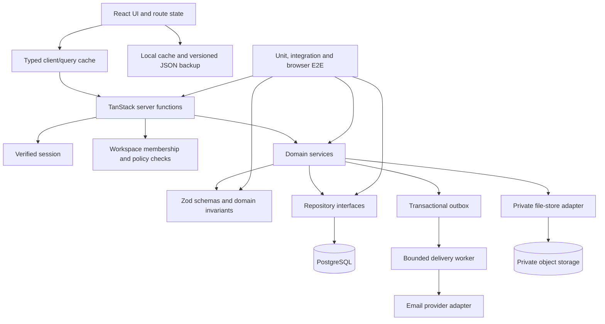

# Taskora full-system blueprint

**Status:** Proposed target architecture and acceptance contract  
**Reviewed:** 2026-10-18  
**Canonical implementation target:** GitHub Track A — `Loofy147/Taskora`  
**Current GitHub baseline inspected:** `main` at `0accd42982a2b4809f9d905db569e5e21887756e`  
**Separate staging surface:** [AppDeploy Track B](https://taskora-ube0f6.v2.appdeploy.ai/), deployed revision `1792339899173` (v16 local-first reliability batch; E2E verdict not returned)

This document is a system-wide preparation artifact. It is not a claim that the proposed architecture is already implemented, and it does not authorize a deployment or enable cloud persistence.

## 1. Executive decision

Taskora should become a reliable task-and-work coordination system for individuals and small teams—not a set of screens tied to a browser store or a cloud snapshot endpoint.

The full system should be built as a **modular monolith with explicit service and repository boundaries**, using the existing React/TanStack Start stack, Better Auth, PostgreSQL, and PGlite for isolated tests/preview. Do not introduce microservices, a second auth provider, a second database provider, or a new hosting platform until measured constraints justify it.

The order of work is:

1. Lock product semantics, authorization rules, domain invariants, and test contracts.
2. Configure and verify a real staging environment with Better Auth and PostgreSQL.
3. Replace whole-workspace writes with authenticated, per-entity operations and transactional migrations.
4. Make the current UI operate over those domain services; keep browser state as a cache/draft, not a competing source of truth.
5. Add real workspaces, membership, invitations and enforceable roles.
6. Complete schedules, search, navigation, reports, file storage, notification delivery and operational recovery in separately verifiable increments.
7. Release only after the exact candidate passes browser E2E, security, migration, backup/restore and operational gates.

The current cloud-revision issue is not the system objective. Track B cloud snapshot checks are explicitly deferred. The system objective is a dependable core whose important state transitions can be verified and recovered.

## 2. Evidence ledger and implementation tracks

### Established from repository inspection

- The GitHub application uses React 19, TanStack Start/Router, Zustand, Better Auth, PostgreSQL support through `pg`/Kysely and PGlite integration tests.
- `src/lib/store.ts` is still the primary operational task state and persists via Zustand/localStorage.
- `src/lib/workspace-data.ts` and `src/lib/workspace-storage.server.ts` implement a **personal whole-workspace snapshot bridge** with validated data, server-derived identity and compare-and-swap revisions; this is not normalized per-task CRUD.
- `.grok/app-env.json` sets `VITE_AUTH_ENABLED=false` and database provisioning to false. Durable authenticated persistence is not enabled in the shipped repository environment.
- The workspace migration defines personal workspaces, membership records, JSONB snapshot state and a minimal event ledger.
- The repository's backup contract is `taskora.workspace-backup`, version 1, with a 10 MiB limit. The current code includes a hard-coded prototype identity (`ME = "hichem"`) that must not become a production authorization authority.
- GitHub CI runs tests, typecheck, lint and build. The build migration runner skips actual database migration work when `DATABASE_URL` is absent. CI green without that variable is not evidence of a live migration.
- Track B AppDeploy code is a separate implementation and does not synchronize to Track A. Its v16 UI explicitly defers cloud snapshots, auto-sync and per-task cloud mode.
- AppDeploy reported `ready` with empty frontend/backend/network error arrays for revision `1792339899173`, but an executed E2E verdict was not returned.

### Decision

**Track A is the canonical full-system implementation target.** Track B is retained as a separate staging/UX smoke surface only; do not port features implicitly or infer Track A correctness from Track B status.

### Open evidence

- Live Better Auth sign-in/session lifecycle against a real configured staging environment.
- Migration application and idempotency against a disposable real PostgreSQL database.
- Browser persistence round-trip through authenticated HTTP/server functions.
- Cross-account and cross-workspace authorization denial.
- Normalized per-entity CRUD, stale-write recovery, browser backup round-trip and restore drill.
- Executed, inspectable E2E verdict for the latest Track B test definitions.

## 3. Product contract: the outcomes Taskora must guarantee

A user must be able to move through this complete work loop without losing context:

1. Capture a task with a required title and useful description.
2. Place it in a project, set a priority/status, and define one or more assignees.
3. Distinguish a **date-only deadline** from an actual **scheduled time interval**.
4. Locate work by query, project, status, priority, assignee and date; switch Board/List/Calendar without losing the current context.
5. Update status, description, assignment, tags, subtasks or comments; understand whether the save succeeded, conflicted, or remains only local.
6. See team workload and project progress derived from authoritative data, not seeded figures represented as live analytics.
7. Export a portable backup, validate/import it safely, and recover from rejected or interrupted operations.
8. For shared workspaces, know who may read or mutate an object and who is accountable for it.

The UI must never imply that a sample member is a real account, a role label is an authorization grant, an attachment reference is an uploaded file, a local toast is a delivered notification, or a successful deployment status proves persisted data.

## 4. Target architecture

### Boundary rules

- **UI/presentation:** renders current server state plus explicit optimistic drafts. It does not grant access, infer permissions, or own durable truth.
- **Router/navigation:** gives meaningful, bookmarkable locations for Board, List, Calendar, Projects, Team and task details. Navigation state can be restored by browser history and deep links. Access checks still happen server-side.
- **Client data layer:** typed query keys, loading/empty/error states, mutation state, conflict recovery and cache invalidation. Avoid two independently mutable global stores for the same durable entities.
- **Domain services:** hold use cases such as create task, assign task, move status, create project, invite member, accept invite and attach file. Every write validates input and calls an authorization policy.
- **Repository interfaces:** isolate PostgreSQL, object storage, mail and future integrations. Provider changes require implementing the interface and passing contract tests, not rewriting domain logic.
- **Database:** PostgreSQL is the durable source of truth in the full system. PGlite is appropriate for deterministic integration tests and local preview, but preview persistence must not be marketed as production durability.
- **Async delivery:** only work that benefits from retries/latency isolation goes through a durable outbox/worker. Core task mutations remain transactional and synchronously acknowledged.
- **Local storage:** holds view preferences, a cache/draft and user-generated export files. Do not silently claim a browser copy is a durable server backup. A future offline-write queue is a separate capability with conflict semantics and its own tests.

Start with one deployable application and bounded modules. Split into services only after measured load, independent scaling, reliability or team ownership needs justify the operational cost.

## 5. Domain model and persistence target

The following is a target data contract, not a claim that all tables exist today.

| Entity | Purpose and minimum invariants |
|---|---|
| `users` / Better Auth identity | Canonical authenticated principal; identity is resolved server-side, never trusted from request body fields |
| `workspaces` | Tenant/authorization boundary; personal workspace is a special case, not a separate authorization model |
| `workspace_memberships` | Unique `(workspace_id, user_id)`; role belongs to a membership and is checked on every protected operation |
| `workspace_invitations` | Workspace, normalized email, role, inviter, hashed one-time token, expiry, accepted/revoked timestamps |
| `projects` | Workspace-scoped name/description/status, optional target date and creator |
| `tasks` | Workspace/project, title, summary/description, status, priority, due date, schedule interval, creator, version, created/updated/archived timestamps |
| `task_assignees` | Join table for zero or more real members per task; assignment must target an active member of the same workspace |
| `subtasks` | Parent task, order, title, completion state; parent and subtask must belong to the same workspace |
| `comments` | Task, author membership, body, created/updated timestamp; cannot attach a comment to a task outside the active workspace |
| `attachment_metadata` | Workspace/task, private object key, original filename, detected content type, byte count, checksum, uploader, scan status; file bytes live in object storage |
| `notification_preferences` | Per-user/per-workspace delivery preferences and consent/unsubscribe state |
| `notification_outbox` | Transactionally recorded event, idempotency key, attempt count, next retry, delivery state and safe error class |
| `audit_events` | Actor, workspace, action, target, timestamp, correlation ID and minimal redacted metadata; never log tokens or full task bodies by default |
| `idempotency_records` | Scoped idempotency key, request hash, outcome/reference and expiry for retryable commands |

### Database invariants

- Every tenant-owned row has an explicit `workspace_id`, foreign keys, and indexes supporting workspace-scoped access.
- A task's project, creator and assignees must be members/objects valid in the same workspace.
- Status and priority enums are validated in both request schema and database constraints where practical.
- Time intervals require both endpoints or neither; `end > start`.
- Mutation commands carry `expected_version` (or equivalent compare-and-swap token). A stale write returns a predictable `409` and never overwrites newer state.
- A client-provided workspace/user/role field is not authority. The server takes actor identity from the verified session and checks active membership before fetching or mutating protected records.
- Use transactions for multi-row changes (membership, project/task relationships, delete/archive, invitation acceptance and outbox insertion).
- Use an archive/soft-delete policy for recoverable business entities until retention and deletion semantics are explicitly decided. Object deletion, task deletion, and audit retention are separate operations.
- Keep unique constraints and bounded indexes as correctness controls; do not depend on disabled UI controls for integrity.

## 6. Authorization and roles

Role labels and responsibility descriptions are different data. A responsibility is human-readable accountability metadata; it never grants system access.

Initial capability matrix (to be enforced in domain services, not just rendered controls):

| Capability | Owner | Admin | Member | Viewer |
|---|---:|---:|---:|---:|
| Read workspace and its projects/tasks | Yes | Yes | Yes | Yes |
| Create/update/move tasks and comment | Yes | Yes | Yes | No |
| Assign members of same workspace | Yes | Yes | Yes, within workspace | No |
| Create/archive projects | Yes | Yes | Per workspace policy; default no | No |
| Invite members / manage membership roles | Yes | Yes, except owner transfer | No | No |
| Change workspace settings | Yes | Yes, except owner/security transfer | No | No |
| Export data they are authorized to read | Yes | Yes | Policy-limited; default assigned/work-owned data only | Policy-limited read export |
| Transfer ownership or delete workspace | Yes, explicit re-auth/confirmation | No | No | No |

Implementation decisions required before enabling sharing:

- Specify whether Member permissions apply to every task in a workspace or only assigned/created tasks. **Proposed initial policy:** members may read and work on the workspace's tasks, but only owner/admin manage membership and project/workspace settings. If least-privilege needs require row-level task privacy later, model it explicitly.
- Enforce workspace membership in every server operation and query. Return a consistent denial for missing membership; do not reveal whether another tenant's object exists.
- Invitation acceptance is a transaction that checks token hash, expiry, normalized invitee email, workspace state, current membership and requested role. Token is one-time and cannot be used to self-escalate.
- Revoke access immediately through membership state; authorization must not rely only on a cached role in a long-lived client.
- If PostgreSQL RLS is adopted, treat it as defense in depth after testing the actual pooled-connection/transaction identity propagation and database role. Keep application-level authorization regardless.

## 7. Task lifecycle, responsibility and schedules

### Task contract

- Title is required and trimmed; schema limits are explicit and shared by UI, service and backup parser.
- Status transitions are validated centrally. The first release can use To do → In progress → Done, while preserving an explicit path to reopen work.
- Priority is one of Low/Medium/High/Urgent (align existing types with UI and schema before widening).
- Assignment is to real workspace memberships, not arbitrary email/name strings or sample profile IDs.
- Creator, assignees and watchers are separate concepts. Do not infer "responsible" from a free-text role field.
- Comments and subtasks are independently versioned or transactionally nested with clearly defined deletion behavior.
- Mutations are deterministic and return the canonical persisted record/version.

### Schedule contract

- A **due date** is a calendar date and does not automatically imply a fixed time.
- A **scheduled interval** has both start and end instants. Store instants in UTC (`TIMESTAMPTZ`) and retain the relevant IANA timezone/workspace timezone for interpretation and display.
- Validate calendar dates instead of comparing arbitrary strings. Require both interval endpoints and enforce `end > start`.
- Handle daylight-saving gaps/ambiguous local times deliberately; show the resolved time/offset rather than silently shifting a meeting.
- Same-assignee overlap is initially a **warning with explicit override**, not an unconditional database rejection. A work task can overlap legitimately; room/resource booking can add stricter exclusion rules later.
- Define whether assignment or workspace timezone controls a task before enabling recurring schedules. Recurrence remains deferred until timezone and DST semantics are tested.
- Calendar and agenda derive from the same task query and date/time contract as List and Board. A task should not disappear just because it has a due date without a scheduled start time.

## 8. Service and mutation contracts

Keep use cases typed and independent of UI components. Initial operation families:

- Tasks: `listTasks(filters, cursor)`, `getTask(id)`, `createTask(input, idempotencyKey)`, `updateTask(id, patch, expectedVersion)`, `moveTask(id, status, expectedVersion)`, `archiveTask(id, expectedVersion)`.
- Projects: list/get/create/update/archive with workspace scoping.
- Subtasks/comments: create/update/delete with parent/workspace validation and bounded request bodies.
- Membership/invitations: list/create/resend/revoke/accept and role changes with explicit authorization.
- Schedule: list by range, agenda view, optional collision analysis returning conflicts as domain data.
- Backup: export authorized data; parse/validate/preview restore; transactional import with a migration version; write an audit event after commit.
- Attachments/notifications: create upload intent, finalize verified upload, authorize download, notification preference and outbox commands.

Every mutation should follow the same flow:

1. Parse and bound the request (Zod/domain schema).
2. Resolve actor from verified session.
3. Load target workspace/membership and enforce operation-specific policy.
4. Validate referenced objects and state transition.
5. Begin transaction; compare entity version/idempotency key; commit entity changes and outbox/audit event together.
6. Return the authoritative record/version or an explicit `400/401/403/404/409/413/429/503` error contract.
7. Update/invalidate client cache from the confirmed result; on `409`, preserve the draft and offer refresh/reapply instead of silent overwrite.

Do not expose the current personal snapshot `PUT` bridge as the permanent mutation API. It remains a migration adapter until normalized per-entity operations pass their tests.

## 9. Navigation and interface operating model

- Use routes for main work areas and meaningful deep links for task/project details. Back/forward, refresh and shared deep links should produce predictable state.
- Global search, filters and sort need explicit state rules: entering a new area should not unexpectedly erase filters; a visible Clear filters action resets them deterministically.
- Preserve one clear primary action for each context. Keep advanced system controls, provider state and migration actions away from the everyday task path.
- All views need visible loading, empty, validation, conflict, offline/unavailable and success states. A success toast must follow a confirmed write, never precede it.
- Mobile-first requirements: navigation reachable by thumb, no accidental horizontal overflow, keyboard/screen-reader labels, sensible focus return after modals, accessible contrast and usable forms at 375 px viewport.
- The current Settings disclosure that says cloud storage is deferred is the intended staging behavior; remove or re-enable it only when a verified capability exists.
- Use a design system for tokens, spacing, typography, buttons, status/priority semantics, form errors and responsive breakpoints. Avoid repeated one-off CSS that makes later workflow changes fragile.

## 10. Local state, backups and migration

- The canonical GitHub backup format is `taskora.workspace-backup` version 1, up to 10 MiB, with strict validation. It is not encrypted and must be treated as private user data.
- The current prototype's hard-coded `ME` identity must be replaced by verified session identity before server persistence can be enabled; imported profile/member data is not authoritative membership.
- A future snapshot-to-relational import must provide a preview (task/project/comment/member counts and validation errors), require an explicit confirmation, and execute in a transaction with idempotent import identity.
- Import rejects unknown schema versions, duplicate IDs, broken references and over-limit payloads before changing data. A failed import leaves the original dataset unchanged.
- Do not maintain indefinite dual writes between browser snapshots and relational records. Define one cutover point, an import status, rollback/reconciliation path and deterministic audit record.
- Local export is a recovery copy, not a server backup. Production PostgreSQL requires automated backups/PITR appropriate to the hosting provider, restore drills and a written recovery objective.
- Track B currently has different local snapshot schema/size constraints. Do not assume the Track A backup parser can import a Track B JSON file without an explicit converter.

## 11. Files, notifications, reporting and integrations

### Files

Current attachments are metadata references. A future real file path uses private object storage behind an adapter, with opaque object keys, byte/content-type limits, checksums, malware scanning, private access checks and short-lived download URLs. Verify workspace membership for every upload, finalize and download operation. Never expose public permanent URLs for private business files.

### Notifications

UI notices are not delivered notifications. Durable email/digest/in-app notifications require a transactional outbox, idempotent delivery, bounded retries, dead-letter/error reporting, user preferences, consent/unsubscribe support and observability. A task mutation and its outbox item must commit atomically.

### Reports

Reports must have versioned definitions for completion, workload, overdue and schedule metrics. Apply the same authorization scope as the underlying records. Never label seeded/demo numbers as live external analytics. Provide CSV/export later only after its data scope is defined.

### Integrations

Put external providers behind typed adapters and explicit scopes/permissions. Start with read-only integrations and one narrow workflow before write scopes or autonomous actions. Every integration needs token storage, revocation, timeout/retry policy, audit records and a disconnected/error state. Do not add AI/automation before the core domain and authorization contracts are stable.

## 12. Reliability, security and operations

Initial requirements to design and measure:

- **Availability/recovery:** migration rollback/recovery procedure, PostgreSQL backup and tested restore, explicit browser backup, visible partial/unavailable states.
- **Consistency:** entity versions, transactions, unique/foreign-key constraints, idempotency for retryable writes, no hidden last-write-wins.
- **Isolation:** automated tests for two workspaces/users and unauthorized object IDs on every operation family.
- **Privacy:** no credentials, session tokens, full task descriptions/comments or file contents in routine logs. Use request/correlation IDs and redacted structured errors.
- **Payload/abuse controls:** bounded list pages, text lengths, uploads, invite rate limits, server-side timeouts and request size caps.
- **Observability:** track request outcomes/latency, validation and authorization denials, conflicts, DB availability, outbox lag/failures, import/restore outcome and client errors.
- **Accessibility:** keyboard navigation, accessible labels, focus management, reduced motion where relevant, contrast and responsive behavior.
- **Performance:** add a repeatable representative dataset and measure list/search/calendar latency and client bundle size. Set numeric budgets only after measuring the current baseline; do not suppress a chunk warning to make CI appear green.
- **Release traceability:** every gate records repository ref/commit, schema/migration version, deployed revision, test IDs and outcomes, environment, rollback decision and known limitations.

## 13. Verification contract

A capability is not "done" because its source or button exists. Use these evidence labels in the roadmap and release ledger:

- **ESTABLISHED:** backed by source, schema or configuration inspection at a specific commit/revision.
- **EXPERIMENTALLY_SUPPORTED:** an actual named test/run/browser scenario has a recorded result.
- **USER_REPORTED:** result reported by a user but not independently captured.
- **INFERENCE / PROPOSED:** target design or recommendation, not implemented fact.
- **UNKNOWN / OPEN:** missing evidence or unresolved dependency.
- **CONTRADICTED:** observed evidence disproves the claim.

Required test layers:

1. **Unit:** validators, date/time rules, filters, role policy, transition rules, migration planning, idempotency semantics.
2. **Integration:** real domain services with isolated PostgreSQL/PGlite, transactions, foreign keys, compare-and-swap, outbox atomicity and failure rollback.
3. **Authorization matrix:** each role against each read/write operation; anonymous, expired, revoked membership and object-ID substitution.
4. **Browser E2E:** task create/edit/move/comment/reload/archive; filter/navigation/back; backup export/import; schedule conflicts and override; invitation flow; file access if implemented.
5. **Operational drills:** migration on empty/current schema, re-run for idempotency, backup restore, DB unavailable, mail provider unavailable and rollback.
6. **Static/CI:** `npm ci`, `npm test`, `npm run typecheck`, `npm run lint`, `npm run build`, auth invariant check, migration preflight and executed browser tests. CI must report a separate skipped/not-applicable status when no real DB is configured; a skipped migration is not a pass.

## 14. Release gates

| Gate | Purpose | Exit condition |
|---|---|---|
| G0 — baseline and semantics | Choose canonical track; lock product invariants; inspect current tests | Blueprint/backlog reviewed, no track confusion, capability-to-test map exists |
| G1 — auth + PostgreSQL staging | Real identity and durable DB configuration | Migrations apply/idempotent; auth lifecycle passes; two-account isolation passes |
| G2 — domain services | Normalized per-entity persistence | Task/project/comment/subtask CRUD, versions, idempotency, transactions and failure recovery pass |
| G3 — UI integration | Reliable daily workflow | Board/List/Calendar/task details use authoritative services, visible conflicts, local/remote state behavior is explicit |
| G4 — collaboration | Real workspace membership and invitations | Owner/admin/member/viewer rules and invite replay/expiry/revocation tests pass |
| G5 — supporting services | Files, notifications, reports and integrations | Private file lifecycle, outbox/retry/consent, authorized reports and failure states pass |
| G6 — production operations | Operability and security | Restore drill, monitoring, dependency/security checks, rate limits, privacy review and rollback drill pass |

**Stop rule:** any account-isolation failure, unexplained data loss, ambiguous migration, broken restore, stale-write overwrite, or missing E2E evidence blocks release. Do not trade these gates for visual polish.

## 15. Architecture decisions

| ID | Decision | Rationale | Revisit condition |
|---|---|---|---|
| ADR-001 | Track A GitHub source is canonical for full-scale engineering | It already contains the typed domain/UI structure and Better Auth/PostgreSQL boundary; Track B is independent | Only if the product owner formally chooses to replace the canonical implementation |
| ADR-002 | Use a modular monolith first | Easier transactions, tests, deployment and ownership; no measured need for microservices | Measured scaling/independent release/operational constraints |
| ADR-003 | PostgreSQL is the durable system of record; PGlite is test/preview only | Aligns with the existing repository implementation and relational authorization model | A measured portability/operational need with a proven adapter contract |
| ADR-004 | The snapshot bridge is a migration adapter, not permanent CRUD | Whole-workspace JSON writes have coarse conflicts and poor sharing semantics | Retain only if a user-approved single-user product intentionally stops at personal snapshots |
| ADR-005 | Cloud features remain gated until real end-to-end verification | The shipped auth/database config is disabled and Track B cloud E2E is unverified | Re-enable per gate with specific tests and operational evidence |
| ADR-006 | Files and delivered notifications are separate milestones | They introduce object-store, privacy, scanning, retry and delivery obligations | Start only after the core domain and authorization are stable |

## 16. Open decisions before implementation expands

These are explicit decisions, not reasons to pause preparing:

1. Whether membership authorizes all task reads for Members or limits rows to assigned/created tasks. Default proposal: all tasks within the workspace, with explicit owner/admin control over membership/settings.
2. Whether notifications are in-app only for the first shared-workspace release, with email after the outbox is operational.
3. How task timezone is chosen: workspace timezone initially, with timezone stored for scheduled intervals.
4. Whether offline task mutation is a launch requirement. Default proposal: local view cache and export are supported first; reliable offline-write queue is a separate feature.
5. Whether to enable team collaboration in the first live release or launch a personal authenticated workspace first. Proposed plan: personal auth/storage first, then team membership in a later gate.
6. Product limits for task count, upload size, invitation rate, retention and recovery objectives; measure and set before production.
7. Hosting-specific provider and secret configuration. Values must be entered into approved deployment secret storage, never written into repository docs or chat.

Until these decisions are explicitly changed, follow the defaults in this blueprint and record revisions as architecture decisions rather than silently changing behavior.
